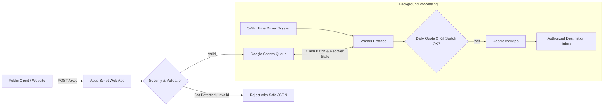

# Centralized Secure Email Service

> A lightweight, zero-cost, security-conscious centralized email delivery service built exclusively for Google Apps Script (V8 runtime) and Google Sheets.

Designed specifically for **low-volume personal projects, portfolio contact forms, and small apps (< 100 messages/day)** that need reliable transactional notifications without spinning up paid servers, databases, or third-party mailing services.

---

## Project Overview & Purpose

Many developers face an unnecessary dilemma for contact forms and low-volume alerts:
- **Option A**: Pay for external mail services (SendGrid, Postmark, AWS SES, Resend) and maintain separate credit cards, API keys, and microservices.
- **Option B**: Expose client-side credentials in public frontend code or run an open web endpoint that spammers quickly discover and abuse.

**Centralized Secure Email Service** solves this by leveraging your existing **Google Workspace or personal Gmail account**:
- **Zero Paid Dependencies**: Runs 100% inside Google Apps Script (free tier) and Google Sheets.
- **No External Backend**: No Vercel functions, Render, Cloud Run, Supabase, or Redis needed.
- **Queue & Decoupled Delivery**: Public submissions are never sent directly. They are validated, screened for bots, and staged in a private Google Sheet queue. A scheduled worker delivers emails periodically in bounded batches.
- **Multi-Tenant Support**: Reusable across multiple distinct websites (e.g., your personal portfolio, side apps like DotUp V3, internal scripts) with individual per-project rate limits and kill switches.

---

## Architecture at a Glance



### Key Security & Reliability Pillars
1. **Immutable Recipient**: The destination inbox is fixed server-side. Attackers can never inject arbitrary recipients or use your service as an open mail relay.
2. **Multi-Tier Abuse Prevention**:
   - **Honeypot Trap**: Invisible field rejects automated bot submissions without annoying human visitors.
   - **Optional Turnstile / reCAPTCHA**: Ready to toggle on anytime; disabled by default for zero-friction setup.
   - **CRLF & HTML Sanitization**: Header injection protection and full HTML entity escaping on all user content.
3. **Idempotency & Deduplication**: Client-provided `idempotencyKey` prevents duplicate emails on browser reloads or network retries.
4. **Crash & Quota Resilient**: Gracefully halts when Gmail's daily quota is reached; automatically recovers jobs if a script execution is interrupted.

---

## Complete Documentation Index

To help you understand, configure, and customize every part of the service, check out the specialized guides:

| Document | Description |
| :--- | :--- |
| [**Architecture Guide**](docs/ARCHITECTURE.md) | Deep dive into system components, sequence diagrams, queue state machine, and design trade-offs. |
| [**Integration Guide**](docs/INTEGRATION.md) | Copy-paste code examples for HTML/JS forms, React/Next.js hooks, and Node.js/Python HMAC backends. |
| [**Configuration Reference**](docs/CONFIGURATION.md) | Comprehensive table of all Script Properties, default limits, and project registry settings. |
| [**Deployment Runbook**](docs/DEPLOYMENT.md) | Step-by-step instructions for setting up Google Sheets, clasp pushing, and web app publishing. |
| [**Security & Threat Model**](docs/SECURITY.md) | Threat boundaries, abuse scenarios, fail-closed design, and Google Apps Script platform limits. |
| [**Operations & Incident Runbook**](docs/OPERATIONS.md) | Health inspection, emergency kill switches, dead-letter requeueing, and data retention cleanup. |
| [**Testing Matrix**](docs/TESTING.md) | Automated unit test results and manual verification test plan for Google Workspace features. |
| [**Implementation Checklist**](docs/IMPLEMENTATION_CHECKLIST.md) | Feature-by-feature verification checklist and code reference mappings. |

---

## 5-Minute Quickstart

### 1. Create Your Queue Spreadsheet
1. Create a private Google Sheet at [sheets.new](https://sheets.new) named `Email Service Queue`.
2. Copy the **Spreadsheet ID** from the URL (`https://docs.google.com/spreadsheets/d/<SPREADSHEET_ID>/edit`).

### 2. Deploy to Google Apps Script
1. Open [script.google.com](https://script.google.com) and create a **New project**.
2. Push or copy the files from [`src/`](src/) into your Apps Script editor.
3. Go to **Project Settings (Gear icon) > Script Properties** and add:
   - `SPREADSHEET_ID`: `<YOUR_SPREADSHEET_ID>`
   - `DESTINATION_EMAIL`: `your-email@example.com`
4. In the editor toolbar, select the function **`initialSetup`** and click **Run**. Grant standard Google permissions.
   *(This automatically creates your `Queue` and `SecurityLogs` sheets and installs the 5-minute recurring background trigger!)*
5. Click **Deploy > New deployment**:
   - Type: **Web app**
   - Execute as: **Me**
   - Who has access: **Anyone**
6. Copy your public Web App URL (`https://script.google.com/macros/s/.../exec`).

---

## API Contract

### 1. Health Probe (`GET /exec`)
```bash
# Set your deployment URL in your shell (replace with your actual URL)
DEPLOY_URL="https://script.google.com/macros/s/<YOUR_DEPLOYMENT_ID>/exec"

curl -L "$DEPLOY_URL"
```
**Response (`200 OK`):**
```json
{
  "success": true,
  "service": "Centralized Secure Email Service",
  "version": "1.0.0",
  "status": "ONLINE",
  "timestamp": "2026-10-15T18:00:00.000Z"
}
```

### 2. Submit Contact Form Message (`POST /exec`)
```bash
# Note: Always use -L to follow Apps Script's 302 JSON echo redirect
curl -L "$DEPLOY_URL" \
  -H "Content-Type: application/json" \
  -d '{
    "projectId": "portfolio",
    "type": "contact",
    "data": {
      "name": "Alex Smith",
      "email": "alex@example.com",
      "subject": "Project Enquiry",
      "message": "Hello, I would like to discuss a project with you."
    },
    "website": "",
    "idempotencyKey": "unique-uuid-12345"
  }'
```
**Response (`200 OK`):**
```json
{
  "success": true,
  "code": "ACCEPTED",
  "jobId": "job_1a2b3c_xyz",
  "status": "PENDING",
  "message": "Submission accepted and queued for delivery."
}
```

### 3. Verify Bot Defense (Honeypot Trap Test)
```bash
# Submitting with a populated 'website' honeypot field is rejected immediately
curl -L "$DEPLOY_URL" \
  -H "Content-Type: application/json" \
  -d '{
    "projectId": "portfolio",
    "type": "contact",
    "data": {
      "name": "Bot Name",
      "email": "bot@example.com",
      "subject": "Spam",
      "message": "Buy crypto"
    },
    "website": "https://malicious-spam-site.com"
  }'
```
**Response (`200 OK`):**
```json
{
  "success": false,
  "code": "HONEYPOT_TRIGGERED",
  "message": "Bot activity detected."
}
```

---

## Local Testing

The project includes an automated test runner validating all validation checks, honeypot filters, queue deduplication, and HMAC signatures:

```bash
python3 -m unittest discover -s tests -p "test_*.py" -v
```

All 9 test suites execute locally with 100% passing results without requiring external network dependencies.
