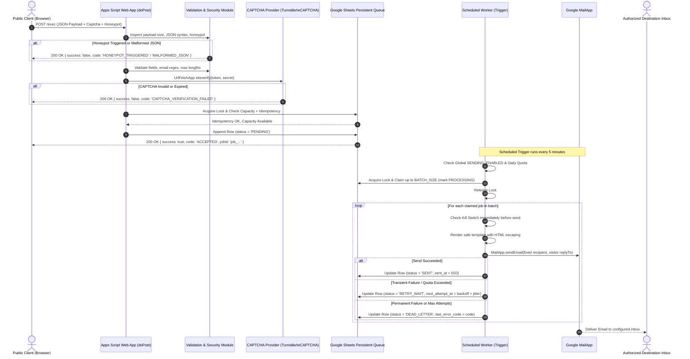
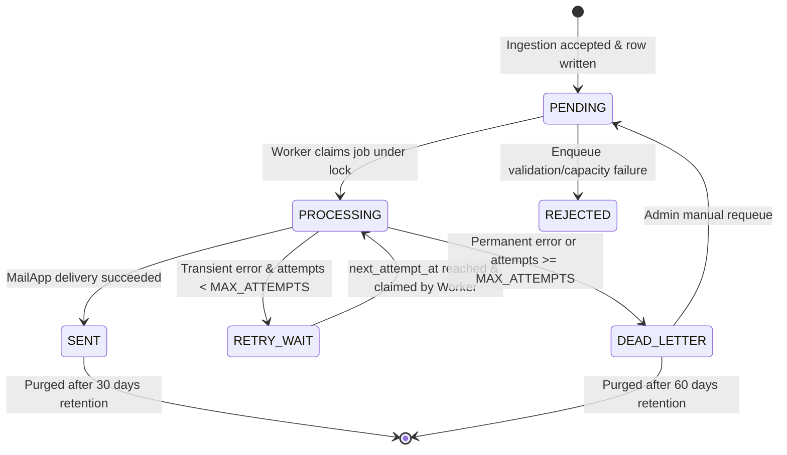

# Architecture Documentation: Centralized Secure Email Service

## 1. System Overview & Core Philosophy

The Centralized Email Service is built to serve multi-tenant client applications (e.g. personal portfolio contact forms, DotUp V3, notification engines) using a unified serverless infrastructure within Google Workspace.

To maintain maximum security, stability, and zero external costs:
1. **Zero External Backend / Database**: No VPS, Render, Supabase, or Redis.
2. **Decoupled Asynchronous Processing**: Client requests **never** send emails synchronously. Every request is staged in a persistent queue.
3. **Strict Ingestion vs. Delivery Separation**: The public Web App handles ingestion and authorization. A private time-driven trigger handles batch processing and email delivery.
4. **Recipient Immutability**: Public clients cannot alter destination inboxes, CC/BCC, or raw template HTML.

---

## 2. Component Diagram & Request Flow

---

## 3. Queue State Machine

Every submission moves through well-defined lifecycle states:

### State Definitions:
- `PENDING`: Validated and persisted in Google Sheets; awaiting worker dispatch.
- `PROCESSING`: Claimed by an active worker execution. If a worker crashes, any job in `PROCESSING` for > 15 minutes is automatically recovered back to retry.
- `RETRY_WAIT`: Scheduled for subsequent retry with exponential backoff and jitter.
- `SENT`: Delivered successfully to destination inbox via `MailApp`.
- `DEAD_LETTER`: Permanently failed (e.g. invalid recipient syntax or max attempts exhausted). Retained for manual administrative inspection.
- `REJECTED`: Request failed server-side validation or capacity check prior to acceptance.

---

## 4. Key Architectural Decisions & Trade-offs

| Decision | Rationale | Trade-off / Limitation |
| :--- | :--- | :--- |
| **Google Sheets as Queue** | Zero external infrastructure or database costs; visual auditing directly within Google Workspace. | Concurrency and latency: Google Sheets does not support row-level atomic locking or standard SQL transactions. Mitigated with `LockService` and bounded scanning (last 500 rows). |
| **Decoupled Worker** | Protects public clients from mail delays and isolates email quota exhaustion from API ingestion. | Asynchronous delivery: emails arrive within 0–5 minutes rather than instantaneously. |
| **Fail-Closed CAPTCHA** | Prevents automated spam floods from filling email quotas or compromising mail reputation. | If the CAPTCHA secret is missing or the provider is down, submissions are rejected until resolved. |
| **Hardcoded Inboxes & Allowlisted Templates** | Eliminates open-relay vulnerabilities and prevents malicious users from spamming third parties. | Public clients cannot direct messages to arbitrary recipients. |
| **Short-Lived Lock Releases** | Claims a batch under lock, then releases the lock immediately before slow `MailApp` network calls. | Avoids lock timeouts for concurrent submissions during email delivery. |

